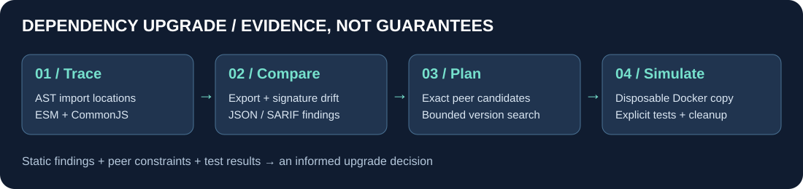

# peer-drift-lab

**Dependency-upgrade QA for JavaScript and TypeScript.** Trace imported APIs,
catch silent declaration drift, solve supplied peer-version candidates, and run
an upgrade in a disposable Docker workspace.

> Peer compatibility and green tests are evidence, not a universal “zero-break”
> guarantee. An unrun simulation is never labeled passing.



## Features

| Feature | Implementation | Boundary |
|---|---|---|
| AST impact tracer | TypeScript AST finds ESM imports, re-exports, import-equals, literal dynamic imports and require; maps symbols to files and lines | Namespace imports check all exports; computed imports yield warnings |
| Silent API drift | Compiler symbol tables and overload sets detect removed exports, required parameters, return and parameter changes, even in patches/minors | Conservative declaration comparison, not a full assignability proof |
| Shadow sandbox | Disposable copy, exact direct-dependency upgrades, script-free install, isolated Docker test phase, cleanup and timeout | Docker required; installs may take minutes; native build scripts disabled |
| Upgrade advisor | Bounded exhaustive search over supplied manifests; minimizes changed package count | Root-level peer constraints only, not a full dependency solver |
| Extra QA | JSON, SARIF 2.1.0, CI failure policy, engine checks, optional peers, scoped packages and subpaths | Unresolved exports and compiler diagnostics are surfaced |

## Installation

Requires **Node 20+**, npm, and optionally Docker for simulation.
This is an npm-packable project. npmjs publication requires separate authorized
npm credentials; a GitHub PAT does not authorize npmjs.org.

```sh
git clone https://github.com/Ai-finder-for-api/peer-drift-lab.git
cd peer-drift-lab
npm ci --ignore-scripts
npm test
node bin/peer-drift.js --help
npm link  # optional: expose peer-drift on PATH
```

Or create and install an archive:

```sh
npm pack
npm install -g ./ai-finder-for-api-peer-drift-lab-0.1.0.tgz
```

After registry publication, the intended install command is:
`npm install -g @ai-finder-for-api/peer-drift-lab`.

## 1. Trace imports

```sh
peer-drift trace --project /path/to/app --output imports.json
```

Scans JS, JSX, TS, TSX, CJS, MJS, CTS and MTS. Ignores common build folders,
node_modules, .git, declaration files and symlinks. require calls are detected
syntactically: a locally shadowed require may cause a false positive. Relative
imports and node: built-ins are ignored.

## 2. Compare updates

Install the application's current dependencies first. Candidates are downloaded
with `npm pack --ignore-scripts`, never installed or executed during inspection.

```sh
peer-drift scan --project /path/to/app --upgrade some-library@1.2.3 \
  --upgrade @scope/other@2.0.0 --output drift.json
peer-drift scan --project /path/to/app --upgrade some-library@1.2.3 \
  --format sarif --fail-on warning --output drift.sarif
```

The baseline comes from PROJECT/node_modules/PACKAGE. Candidate temporary files
are cleaned up. The project is not modified. Candidate transitive types are not
installed; unresolved compiler diagnostics yield review warnings. npm may write
to its normal cache.

Offline demo:

```sh
node bin/peer-drift.js scan --project examples/drift/app \
  --before examples/drift/before --after examples/drift/after
# Expected exit 1: the 1.0.1 patch contains breaking changes.
```

```text
ERROR   PARAMETER_REQUIRED   greet   index.ts:1
WARNING RETURN_TYPE_CHANGED  greet   string -> Promise<string>
ERROR   EXPORT_REMOVED       legacy  index.ts:1
```

Return drift is a warning because not every change breaks a consumer. Use
`--fail-on warning` for conservative CI. No findings means
`no-static-break-detected`, not guaranteed safe.

## 3. Find peer-compatible versions

```sh
peer-drift advise --input examples/candidates.json --output plan.json
```

Input contains `current` version strings and `candidates`, a map from package
name to candidate manifests with version, peerDependencies and optional
peerDependenciesMeta. The bundled example is a fictional widget demonstrating
React 18/19 peer constraints. Supply real manifests from versions you are willing
to deploy; this command does not fetch or invent candidates. To force an upgrade,
restrict that package's candidate set. Otherwise a minimum-change plan can retain
the existing version intentionally.

Output includes exact versions and npm/Yarn/pnpm fragments. npm overrides use
`$package` references to agree with root dependency specs and avoid EOVERRIDE.
Merge selected versions into the existing dependencies, devDependencies or
optionalDependencies sections; do not blindly replace the entire manifest.
Existing overrides are not merged. Review package-manager-specific semantics.

Default budget: 10,000 complete combinations, configurable via maxCombinations
in input. A search-limit result does not prove impossibility. The solver models
one root version per package, not nested transitive trees. API, engines, ordinary
dependency ranges and runtime behavior require separate validation.

## 4. Shadow sandbox

**Executes the project's tests inside Docker. Use a dedicated disposable CI
runner for untrusted projects, not a sensitive Docker host.**

```sh
peer-drift simulate --project /path/to/app --timeout 180000
peer-drift simulate --project /path/to/app --upgrade some-library@1.2.3 \
  --timeout 180000 -- npm test
peer-drift simulate --project /path/to/app --upgrade some-library@1.2.3 \
  -- npm run test:integration
```

Run a baseline first, then the proposed tree. Exact registry versions only.
Original manifest and lockfile are untouched. Baseline uses npm ci with an
existing lockfile; upgrades use npm install against the modified disposable copy
and copied lockfile. Real npm peer resolution may fail. No force or
legacy-peer-deps flags are used.

Defaults:

- Ephemeral containers, sharing only a disposable project copy.
- No host home, environment credentials or Docker socket mounted.
- Read-only root, dropped capabilities, no-new-privileges, non-root UID.
- 1 GiB memory, 2 CPUs, 256 processes, bounded output and execution time.
- Install has network; tests have none unless --allow-test-network is explicit.
- Install hooks disabled; test scripts/pre/post hooks execute inside the container.
- .env*, .npmrc, common credential directories, key files and symlinks excluded.
- Timeout forcibly removes the container and cleans the workspace.
- Docker missing: unavailable, exit 2; never falls back to host execution.

Default image is node:22-bookworm-slim; override with --image, ideally a digest.
Image pulls and npm installs can take minutes: no “in seconds” guarantee.
Secret exclusions are best-effort; secrets embedded in source or lockfiles can
still enter the copy. See [SECURITY.md](SECURITY.md).

## Library API

ES modules:

```js
import { analyze, advise, simulate, traceImports, toSarif }
  from '@ai-finder-for-api/peer-drift-lab';

const report = analyze({
  project: '/work/app',
  updates: [{ name: 'some-library', before: '/work/old', after: '/work/new' }]
});
const sarif = toSarif(report);
const plan = advise({
  current: { a: '1.0.0', b: '1.0.0' },
  candidates: {
    a: [{ version: '2.0.0', peerDependencies: { b: '^2' } }],
    b: [{ version: '1.0.0' }, { version: '2.1.0' }]
  }
});
```

Also exported: snapshotApi(root, subpath?), compareApis(before, after, usage?),
entrypoint, sourceFiles, packageName, peerIssues, parseUpgrade, sandboxCommand,
and async fetchPackage (caller must invoke returned cleanup()). simulate is
synchronous and accepts an argv-array command. Scan schemaVersion is 1.
Analysis never auto-runs tests or auto-applies a plan.

## CI and exit codes

| Exit | Meaning |
|---|---|
| 0 | Scan policy passed, plan found, or simulation passed |
| 1 | Policy violation, no plan, or failed/timed-out simulation |
| 2 | Invalid input, tooling failure or Docker unavailable |

Scan --fail-on error is default; warning includes warnings; none makes findings
non-blocking but does not suppress tool errors. JSON is default, SARIF is available
for scans only. SARIF upload support depends on hosting/account capabilities.

GitHub Actions defines tests on Node 20/22/24 and a separate real Docker smoke
job. Verify actual job results: local success is not CI success. The manual npm
publish workflow reads NPM_TOKEN from the npm-publish environment. Configure an
authorized granular npm token and the correct scope/name before dispatching.

## Known limits

- Not a universal safety guarantee; behavioral changes require meaningful tests.
- Type text/signature comparison may flag harmless changes and miss structure
  hidden behind unchanged alias/interface names. Full assignability, class
  instance method drift and generic equivalence are not implemented.
- Exports resolution prefers types/import over require/default. Wildcard maps,
  custom conditions, dual-package differences, tsconfig aliases, PnP and special
  workspace resolution need manual review.
- Static peer checks cover installed root packages only. npm simulation resolves
  ordinary transitive constraints. Advisor fragments are not build guarantees.
- Simulation is npm-only; no private registry credentials are forwarded. Native
  packages needing install hooks may require a prepared trusted image.
- No automatic mutation, PR creation or background monitoring.

## Development

```sh
npm ci --ignore-scripts
npm test
npm run check
npm audit --omit=dev
npm pack --dry-run
```

Docker unit tests inject process runners; actual Docker integration is separate
and is never silently claimed by mock tests. MIT licensed.
